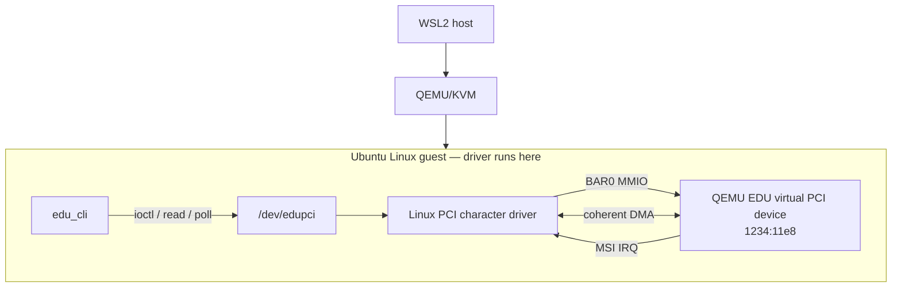

# EduPCI

這是針對 QEMU EDU 虛擬 PCI 裝置（`1234:11e8`）實作的 Linux PCI character driver；driver 在 Ubuntu guest 內執行，涵蓋 PCI probe/remove、BAR0 MMIO、MSI completion、`/dev/edupci` 與 coherent DMA。

[📄 Technical Report](./report.pdf) · [Fresh demo log](./evidence/public_demo_output.txt) · [Architecture figure](./assets/architecture/edupci_architecture.png)

**Runtime verified:** PCI · MMIO · MSI · character device · 64-entry event ring · DMA H2D/D2H

## 專案內容

QEMU EDU 提供可重現的虛擬 PCI target，不需要實體開發板。WSL2 host 啟動 QEMU/KVM；Linux module 的編譯、載入和所有裝置測試都在 Ubuntu guest 進行。

Host 端 Makefile 和 scripts 負責準備 cloud-image guest、同步 source、編譯和透過 SSH 執行測試。Driver 不會載入 WSL2 host kernel。這樣可以保留接近一般 Linux driver 的 PCI API 使用方式，同時在 emulator 結束或 guest 狀態損壞時重新啟動測試環境。

## 架構




## 實作內容

- **PCI / MMIO:** `edu_probe()` 啟用裝置、claim BAR0 並映射 register region；driver 使用 `readl()` / `writel()` 操作 EDU registers。
- **Character device:** `/dev/edupci` 提供固定寬度 ioctl ABI、event `read()` 和 `poll()`。
- **Interrupt / ring:** factorial 與 DMA 正常完成路徑由 MSI IRQ 通知；ISR acknowledge cause、完成等待中的 operation，並將 event 寫入 64 筆 bounded ring。讀取端支援 blocking read、FIFO、wraparound 和 overflow 統計。
- **DMA:** 使用 coherent DMA buffer 分別測試 H2D、D2H，並逐 byte 比對 1、257、4095 bytes。

Factorial 與 DMA 的 ioctl 都在 process context 等待 completion，等待有 timeout；正常成功路徑必須收到 IRQ。Hard IRQ handler 不拿 operation mutex，也不執行可能 sleep 的工作。它 acknowledge device cause、更新必要狀態並喚醒等待者，結果和 user buffer 的處理留在 process context。

Event ring 的 producer 是 IRQ handler，consumer 是 `read()`。`ring_count` 區分空與滿，head/tail 到 64 後繞回；滿時採 drop-new 並累計 overflow，不讓中斷 handler 等待 userspace。`read()` 先在 spinlock 下 snapshot，再於 lock 外 copy；只有 copy 成功才移動 tail。`poll()` 使用同一個 readiness condition，但回報後 event 仍可能被另一個 reader 取走。

Probe 逐項取得 PCI、BAR、DMA 和 IRQ 資源，失敗時依已取得的項目回復；remove 先阻止新操作並喚醒等待者，再等 `operation_lock` 釋放後清 bus mastering 和裝置資源。這個流程讓 idle reload 可以重複執行，但沒有因此宣稱 active unbind 已安全驗證。

UAPI 結構使用固定寬度欄位，不把 kernel pointer 傳給 userspace。DMA 時 CPU 透過 virtual pointer 寫入 coherent buffer，device 使用 DMA API 回傳的 `dma_addr_t`；兩者分開保留。H2D 前的 `dma_wmb()` 和 D2H 完成後的 `dma_rmb()` 表示資料與 command 的順序需求。小型功能測試只證明資料一致，不代表 DMA 比 CPU copy 快。

## Demo

以下截圖由新一輪 `make demo` 輸出產生；文字取自 [`evidence/public_demo_output.txt`](./evidence/public_demo_output.txt)，截圖只加上 terminal 外框。


完整測試另外驗證 ring FIFO、blocking wakeup、wraparound、overflow、user-copy error、DMA signal cleanup，以及三次 idle module reload。詳細結果見 [verification report](./docs/verification_report.md) 和 [independent audit](./docs/final_audit.md)。

實際 `lspci`、module state、測試輸出和 kernel health scan 都保存在 `evidence/`，可逐項對照 README 的驗證狀態。

## Debugging：QEMU 6.2 DMA boundary issue

EDU 規格描述 4096-byte internal buffer，但測試中的 QEMU 6.2.0 在 exact-end DMA range check 會終止 emulator。1、257、4095-byte transfer 可正常完成。driver 現在於寫入硬體前拒絕 4096；4095 是這個 QEMU 版本與測試環境的安全上限，不是通用 EDU 規格。

問題出在測試版本的 `within()` 使用 end-exclusive 範圍，但後續 `edu_check_range()` 又要求結尾地址嚴格落在 buffer 範圍內。回歸測試會確認 4096 在觸碰硬體前回傳 `EINVAL`，並持續驗證三種合法長度的雙向資料內容。原始 emulator failure 和修正後輸出都保留在 `evidence/`。

## 執行方式

```sh
make provision
make test
make demo
make unload
```

`make provision` 建立或啟動 Ubuntu guest、同步 source 並安裝 guest build tools。測試與 demo 透過 SSH 在 guest 內載入 module 和操作裝置。

`make test` 會 clean-build kernel module 和 CLI，接著依序執行 PCI discovery、MMIO patterns、factorial/IRQ、event ring、DMA 和 idle reload tests，最後收集 kernel log health scan。`make demo` 則產生較短的展示輸出；若 guest 已 provision 並啟動，這兩個 target 不需要每次重新下載 VM image。

## 驗證狀態

| 項目 | 狀態 |
|---|---|
| PCI probe/remove、BAR0 MMIO、`/dev/edupci` | Verified |
| MSI completion、blocking I/O、event ring | Verified |
| coherent DMA H2D/D2H：1 / 257 / 4095 bytes | Verified |
| idle module reload | Verified；三次 |
| INTx fallback | Runtime unverified |
| active sysfs unbind | Runtime unverified |

Reload 驗證涵蓋三次 idle unload/load。沒有在讀取、factorial 或 DMA 進行中觸發 PCI sysfs unbind，也沒有注入 stuck-DMA teardown。這些項目不列為已驗證功能。

## 限制

目標是 QEMU EDU virtual PCI device，沒有實體 PCIe bring-up、production IOMMU 驗證或效能測量。MSI 有 runtime evidence；INTx fallback 只有 source review。4095 bytes 是測試中 QEMU 6.2.0 的上限，不代表所有 EDU 裝置。

目前 misc-device 介面以 singleton 管理，一次支援一個 EDU function。Factorial 輸入限定 0–12，讓結果可放入 unsigned 32-bit 欄位；這是本專案 ABI 的範圍，不是 EDU 裝置的一般限制。

## 文件與目錄

- [`report.pdf`](./report.pdf) — 英文技術報告
- [`docs/report.md`](./docs/report.md) — editable report source; install `requirements-report.txt` and run `python3 scripts/build_report.py` to regenerate
- [`docs/architecture.md`](./docs/architecture.md) — request path 與資源生命週期
- [`docs/implementation_walkthrough.md`](./docs/implementation_walkthrough.md) — source walkthrough
- [`docs/qemu_edu_registers.md`](./docs/qemu_edu_registers.md) — register map 與 QEMU 參照
- [`docs/debugging_notes.md`](./docs/debugging_notes.md) — 實際除錯紀錄
- [`driver/`](./driver/) · [`include/`](./include/) · [`user/`](./user/) · [`tests/`](./tests/) · [`scripts/`](./scripts/) · [`evidence/`](./evidence/)

No repository license file is included yet; see the licensing note in the technical report before reuse or redistribution.
