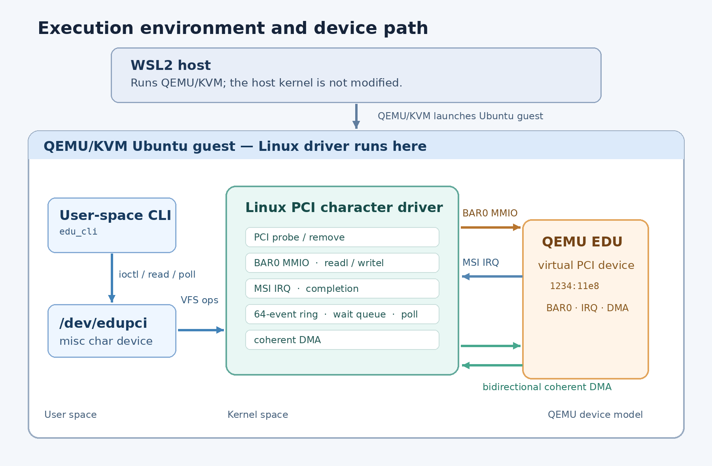
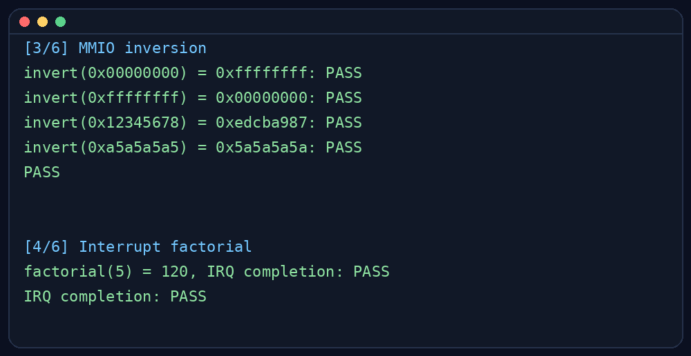
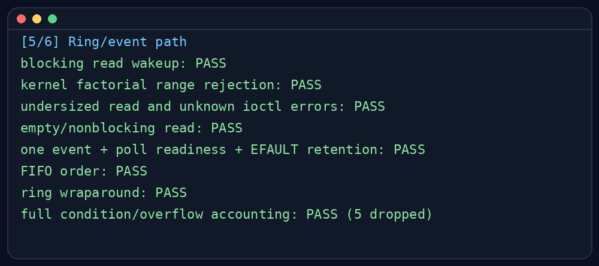
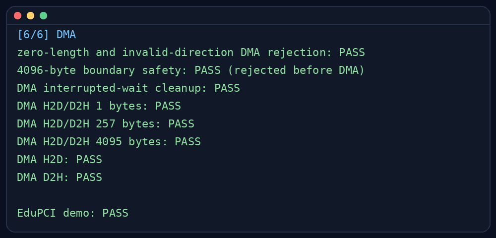

# EduPCI
## Linux PCI Device Driver for QEMU EDU

*Portfolio Systems / Embedded Software Project · 7 October 2026*

**Target: QEMU EDU virtual PCI device (1234:11e8).**

EduPCI implements a Linux PCI character driver and userspace CLI for a virtual device. The project exercises PCI lifecycle management, BAR0 MMIO, interrupt-driven completion, a userspace event stream, and coherent DMA in a reproducible QEMU/KVM guest.

**Stack:** Linux 5.15 · C · PCI subsystem · misc character device · MSI · coherent DMA · QEMU 6.2.0 · Ubuntu 22.04.5 guest.

**Runtime-verified:** PCI probe/remove, MMIO, `/dev/edupci`, MSI completion, blocking read and poll, 64-entry event ring, and H2D/D2H DMA at 1, 257, and 4095 bytes. Evidence is from a fresh guest integration run and demo.

<!-- pagebreak -->

## System Architecture

The WSL2 Ubuntu host runs QEMU/KVM. QEMU presents an Ubuntu Linux guest with the EDU PCI function. The kernel module is built and loaded inside that guest; the host kernel is not modified. The userspace CLI also runs in the guest and communicates through `/dev/edupci`.

| Layer | Responsibility |
|---|---|
| WSL2 host | Runs QEMU/KVM and the VM management scripts |
| Ubuntu guest | Runs the target Linux kernel, driver module, and CLI |
| `edu_cli` | Issues ioctl requests and reads or polls completion events |
| EduPCI driver | Owns PCI resources, BAR0, IRQ handling, the event ring, and DMA setup |
| QEMU EDU | Emulates PCI function `1234:11e8` and its register/DMA behavior |

During `edu_probe()`, the driver enables the PCI function, claims its regions, maps BAR0, checks the device identity, sets a 28-bit DMA mask, allocates a coherent buffer, enables bus mastering, requests an interrupt vector, and registers the misc device. `edu_remove()` blocks new opens, wakes waiters, serializes with active operations, acknowledges pending causes, clears bus mastering, and releases resources.

The PCI function exposes a 1 MiB BAR0 in this guest. The driver only uses the register range defined by the EDU device model. MSI was selected in the verified configuration; INTx fallback is present but was not runtime-tested.

<!-- pagebreak -->

## MMIO and the User/Kernel Interface

The driver matches vendor/device ID `1234:11e8`, claims BAR0, and maps it with the Linux PCI APIs. Register accesses use `readl()` and `writel()` rather than dereferencing a physical address. The EDU inversion register provides a small liveness check: writing a 32-bit value and reading back its bitwise complement verifies the MMIO path end to end.

The CLI opens `/dev/edupci`. Control operations use fixed-width ioctl structures; event records are returned by `read()`, and `poll()` reports whether the ring currently has data. Input ranges and user pointers are checked in the kernel. `read()` preserves ring entries when `copy_to_user()` fails.

The fresh run identified the PCI function, loaded the module, created the device node, and passed four inversion patterns. It also completed a factorial request through the interrupt path.

The ABI boundary is intentionally narrow: userspace supplies operation parameters and buffers, while the driver owns all BAR mappings, IRQ state, and DMA addresses.

<!-- pagebreak -->

## Interrupts and Blocking I/O

The factorial ioctl starts the EDU operation and waits in process context on a completion with a bounded timeout. The device raises MSI when the result is ready. `edu_irq_handler()` reads the cause, acknowledges it, records the result/event, and calls `complete()` for the active operation. The waiting task then resumes and returns the result to userspace.

**Request path:** userspace ioctl → device operation → process waits → MSI → ISR acknowledge → event/completion → process wakes.

The hard IRQ handler cannot sleep and does not take the operation mutex. It performs the small amount of register and shared-state work needed to acknowledge the interrupt, publish an event, and wake the process-context waiter. The longer wait and user-copy operations remain in process context. Polling is used for bounded idle checks and error cleanup; a normal successful factorial or DMA result requires the completion IRQ.

The demo verified `factorial(5) = 120` with IRQ completion. The full test also checks range rejection and interrupted DMA cleanup. MSI was runtime-verified; the INTx fallback was not exercised.

**Context split:**

- Process context can sleep, wait on completions, take mutexes, and copy to/from userspace.
- Hard IRQ context must stay short and non-sleeping; this driver uses an IRQ-safe spinlock for ring state shared with `read()`.

| Step | Context | Driver action |
|---|---|---|
| Start | Process | Serialize the request and program EDU registers |
| Wait | Process | Sleep on a completion with a bounded timeout |
| Complete | Hard IRQ | Read/acknowledge cause, publish event, call `complete()` |
| Return | Process | Resume the ioctl and return result or error |

<!-- pagebreak -->

## Event Ring and Synchronization

The IRQ handler is the producer and `edu_read()` is the process-context consumer. A 64-record bounded ring separates event production from userspace read timing. `ring_count` distinguishes full from empty; head and tail advance modulo the capacity. When full, the driver drops the newest event and increments an overflow counter, so the IRQ handler never blocks waiting for userspace.

`spin_lock_irqsave()` protects the records, indices, count, sequence, and overflow state. It is used because a hard IRQ and process context share the lock. `read_lock` serializes consumers; the consumer snapshots records under `ring_lock`, copies outside the spinlock, and advances the tail only after a successful user copy. A failed copy therefore does not silently consume the record.

An empty blocking `read()` sleeps on a wait queue. `poll()` registers with that queue and checks the same ring readiness condition. Readiness remains advisory: another reader can consume the event after `poll()` reports it.

The test checks blocking wakeup, FIFO order, wraparound, empty/nonblocking behavior, `poll()` readiness, `EFAULT` retention, and overflow. Filling the 64 slots with 69 events retains 64 and reports five drops.

<!-- pagebreak -->

## Coherent DMA

At probe, the driver sets a 28-bit coherent DMA mask and allocates a 4096-byte coherent host buffer. It keeps the CPU virtual pointer and `dma_addr_t` separate. The CPU pointer is used for memory copies; the DMA address is written into the EDU source or destination register. The address is not derived by casting a CPU pointer.

For H2D, userspace data is copied into the coherent buffer, a DMA write barrier orders the data before the command, and EDU reads the host buffer into its internal memory. For D2H, EDU writes device data into the host buffer; after IRQ completion, a DMA read barrier precedes the copy back to userspace. Both paths wait for the DMA completion IRQ and compare the returned bytes with the source pattern.

The fresh test passed both directions at **1, 257, and 4095 bytes**, including byte-for-byte comparison. It also rejected zero length, invalid direction, and the 4096-byte boundary request before MMIO. The run tests correctness in this QEMU guest; it does not claim a speedup or production IOMMU validation.

<!-- pagebreak -->

## Debugging a QEMU 6.2 DMA Boundary Failure

The EDU specification describes a 4096-byte internal DMA buffer. In the tested QEMU 6.2.0 model, a transfer that ended exactly at that boundary caused the emulator process to terminate. A 4095-byte transfer completed. The coherent DMA address was within the configured mask, and the failure occurred after earlier PCI, MMIO, and interrupt checks had passed, so the next step was to compare the version-matched QEMU specification with `hw/misc/edu.c`.

The implementation uses an end-exclusive range helper but then checks the end address as if it had to remain strictly inside the buffer. For a request covering the full 4096 bytes, that exact-end check fails and QEMU raises a fatal range error. The driver now rejects 4096 before programming the DMA registers, and the regression test verifies the rejection while still transferring 1, 257, and 4095 bytes in both directions.

> qemu: hardware error: EDU: DMA range 0x0000000000040000-0x0000000000040fff out of bounds (0x0000000000040000-0x0000000000040fff)!

| Check | Observation |
|---|---|
| Address | Coherent DMA address was within the configured 28-bit mask |
| Boundary | 4095 bytes completed; exact 4096-byte end terminated QEMU |
| Source | Compared the v6.2.0 `within()` helper and `edu_check_range()` in `hw/misc/edu.c` |
| Guard | Reject the request before writing any DMA register |
| Regression | Assert 4096 rejection and verify H2D/D2H at 1, 257, and 4095 bytes |

**Scope:** 4095 bytes is the largest transfer verified against this QEMU 6.2.0 implementation. It is not a universal EDU hardware or API maximum. The device specification still describes a 4096-byte buffer.

The historical emulator failure is retained in `evidence/qemu_dma_boundary_failure.txt`; the successful guard and transfer results are in the fresh demo log and DMA test evidence.

Source checked: the QEMU v6.2.0 EDU [specification](https://gitlab.com/qemu-project/qemu/-/raw/v6.2.0/docs/specs/edu.txt) and [implementation](https://gitlab.com/qemu-project/qemu/-/raw/v6.2.0/hw/misc/edu.c).

<!-- pagebreak -->

## Verification, Limitations, and Lessons

| Area | Status |
|---|---|
| PCI probe/remove and character device | Verified |
| BAR0 MMIO | Verified |
| MSI completion | Runtime verified |
| INTx fallback | Runtime unverified |
| Event ring, blocking read, and poll | Verified |
| Coherent DMA H2D/D2H: 1 / 257 / 4095 bytes | Verified |
| Idle module reload | Three cycles verified |
| Active sysfs unbind during an operation | Not tested |
| Physical PCIe board | Not applicable to this QEMU target |

### What the work exercises

- Linux PCI resource acquisition, error unwinding, and remove ordering.
- User/kernel ABI design and checked user-memory access.
- The process-context and hard-IRQ context split, completion waits, and shared-state locking.
- The distinction between CPU pointers and DMA addresses, plus ordering around coherent DMA.
- Debugging an emulator failure by narrowing the symptom and checking the matching source version.

### Limitations

The target is a QEMU EDU virtual PCI device; no physical-board bring-up was performed. MSI is runtime-tested, while INTx is only source-reviewed. Active sysfs unbind and the exceptional stuck-DMA quarantine path were not runtime-injected. No production IOMMU configuration or performance claim is supported by this evidence.

### Project summary

EduPCI is a Linux PCI character driver for the QEMU EDU virtual device. It demonstrates probe/remove, BAR0 MMIO, MSI completion, a synchronized userspace event ring, and coherent DMA. All runtime evidence comes from the stated Ubuntu guest and QEMU setup.

**License status:** The repository has no license file. `MODULE_LICENSE("GPL")` is kernel module metadata and does not itself grant a repository-wide source license. Confirm authorship and ownership before selecting a license; GPL-2.0-only is a reasonable candidate if the project is original and the author intends to distribute it under a copyleft license.
